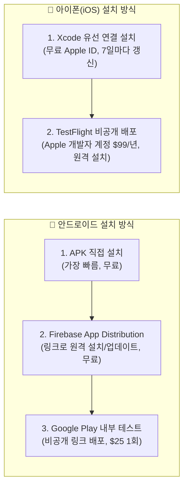

# 🚀 안드로이드 & iOS 빌드 및 배포 가이드 (KMP / CMP)

본 문서는 **일정관리 + 스마트 차계부 (2대 이상 다차량 지원)** 크로스 플랫폼 앱(`Kotlin Multiplatform` + `Compose Multiplatform`)을 **로컬에서 빌드·실행하는 방법**과 **실제 스마트폰(안드로이드/아이폰)에 설치 및 스토어에 배포하는 절차**를 정리한 가이드입니다.

---

## 1. 사전 준비 환경 (Prerequisites)

| 구분 | 필수 도구 및 권장 버전 | 비고 |
| :--- | :--- | :--- |
| **공통** | **JDK 17** (또는 JDK 21) | Gradle 8.10 및 Kotlin 2.0.21 구동용 |
| **IDE** | **Android Studio (Ladybug 2024.2.1 이상)** | JetBrains **Kotlin Multiplatform** 플러그인 설치 권장 |
| **Android** | **Android SDK 35** (minSdk 26 / targetSdk 35) | Android Studio SDK Manager에서 설치 |
| **iOS (macOS 전용)** | **Xcode 16 이상** + Command Line Tools | `xcode-select --install` 확인 필요 |

> [!TIP]
> 회사나 집 PC에서 처음 클론(`git clone`)한 뒤 환경이 잘 잡혀 있는지 점검하려면 [kdoctor](https://github.com/Kotlin/kdoctor) (`brew install kdoctor && kdoctor`)를 실행해 보시면 누락된 설정을 한눈에 확인할 수 있습니다.

---

## 2. 로컬 빌드 및 테스트 명령어 (CLI)

프로젝트 루트 경로(`schedule-app/`)에서 터미널로 아래 명령어들을 실행할 수 있습니다.

### ① 단위 테스트 및 4단계 E2E 테스트 전체 실행
```bash
# Android JVM 기반 공통(commonTest) 유닛 & E2E 테스트 실행
./gradlew :composeApp:testDebugUnitTest
```
* 테스트 결과 리포트 위치: `composeApp/build/reports/tests/testDebugUnitTest/index.html`

### ② 안드로이드(Android) 디버그 APK 빌드 및 설치
```bash
# 1) 디버그 APK 파일 생성
./gradlew :composeApp:assembleDebug

# 2) USB 연결된 안드로이드 폰 또는 실행 중인 에뮬레이터에 즉시 설치
./gradlew :composeApp:installDebug
```
* **생성된 APK 파일 위치**:  
  `composeApp/build/outputs/apk/debug/composeApp-debug.apk`
* **내 안드로이드 폰에 가장 빠르게 설치하는 법**:  
  위 경로에 생성된 `composeApp-debug.apk` 파일을 카카오톡(나에게 보내기), 구글 드라이브, 또는 USB 케이블로 스마트폰에 전송한 뒤 실행하면 스토어 심사 없이 바로 설치해 사용해 보실 수 있습니다.

### ③ iOS (아이폰 시뮬레이터 / 실기기) 프레임워크 빌드
```bash
# Apple Silicon(M1/M2/M3/M4) 맥의 iOS 시뮬레이터용 프레임워크 빌드 검증
./gradlew :composeApp:linkDebugFrameworkIosSimulatorArm64

# 실제 아이폰(iOS 기기)용 프레임워크 빌드 검증
./gradlew :composeApp:linkDebugFrameworkIosArm64
```

---

## 3. 내 스마트폰에 직접 설치해 쓰는 방법 (개인/가족용 배포)

정식 스토어(구글 플레이 / 앱스토어)에 출시하지 않고 **본인이나 가족 스마트폰에 설치해 사용하는 방법**입니다.



### 🤖 안드로이드 폰에 설치하기
1. **Release 서명 키(Keystore) 생성** (최초 1회):
   ```bash
   keytool -genkey -v -keystore release-key.jks -keyalg RSA -keysize 2048 -validity 10000 -alias schedule-app
   ```
2. **Release APK 빌드**:
   * `composeApp/build.gradle.kts`의 `android { signingConfigs { ... } }`에 키스토어 정보를 연결하거나, Android Studio 상단 메뉴 **`Build > Generate Signed Bundle / APK...`**에서 `APK` → `release`를 선택해 빌드합니다.
3. **자동 업데이트 공유 팁 (Firebase App Distribution)**:
   * 새 버전을 빌드할 때마다 카톡으로 APK를 보내기 번거롭다면, 무료인 **Firebase App Distribution**에 APK를 올리면 초대된 이메일(본인/배우자)로 설치 알림이 가고 클릭 한 번으로 업데이트됩니다.

### 🍎 아이폰(iOS)에 설치하기
아이폰은 애플 보안 정책상 APK처럼 파일을 직접 다운받아 설치할 수 없으며, 아래 두 가지 방법 중 하나를 선택합니다.

1. **방법 A: 무료(개인 Apple ID)로 내 아이폰에 설치**
   * 맥(Mac)에 아이폰을 케이블로 연결하고 아이폰 설정에서 **개발자 모드(Developer Mode)**를 켭니다.
   * Xcode의 `Settings > Accounts`에 본인 Apple ID를 추가(Personal Team)합니다.
   * Android Studio(KMP 플러그인) 또는 Xcode에서 실행 대상을 **내 아이폰**으로 지정하고 **Run(▶)**을 누르면 아이폰에 앱이 설치됩니다.
   * *(참고: 무료 계정은 애플 정책상 7일마다 서명이 만료되므로 장기간 실사용 시에는 아래 TestFlight 방식을 권장합니다.)*
2. **방법 B: TestFlight를 통한 무선 설치 (권장)**
   * Apple Developer Program($99/년) 가입 후 Xcode에서 **`Product > Archive`** → **`Distribute App > TestFlight & App Store`**를 선택해 업로드합니다.
   * 아이폰에 **TestFlight** 앱을 깔면 케이블 연결 없이 언제든 원격으로 설치·업데이트할 수 있습니다.

---

## 4. 정식 스토어 출시 절차 (Google Play & App Store)

### ① Google Play Store (안드로이드)
1. **Google Play Console 계정 생성** ($25 최초 1회 등록비)
2. **앱 번들(AAB) 빌드**:
   ```bash
   ./gradlew :composeApp:bundleRelease
   ```
   * 산출물 위치: `composeApp/build/outputs/bundle/release/composeApp-release.aab`
3. **트랙 배포**:
   * **내부 테스트(Internal Testing)** 트랙에 `.aab` 파일을 먼저 업로드하면 심사 대기 없이 몇 분 내로 Play 스토어 비공개 링크를 통해 설치할 수 있습니다.
   * 이후 **프로덕션(Production)** 트랙으로 승격하면 일반 사용자에게 공개됩니다.

### ② Apple App Store (iOS)
1. **Apple Developer Program 등록** ($99/년)
2. **App Store Connect에 앱 등록**:
   * Bundle ID: `com.scheduleapp`
   * 권한 설명(`composeApp/src/iosMain/Info.plist`): 시스템 캘린더 연동 권한(`NSCalendarsUsageDescription`, `NSCalendarsFullAccessUsageDescription`)이 이미 포함되어 있습니다.
3. **Archive & 업로드**:
   * Xcode에서 `Product > Archive` 실행 후 App Store Connect로 업로드 → TestFlight 테스트 또는 App Store 심사 제출.

---

## 5. GitHub Actions 자동 빌드 파이프라인 (CI/CD 예시)

GitHub에 코드를 Push할 때마다 자동으로 테스트를 돌리고 **다운로드 가능한 안드로이드 APK 파일(Artifact)**을 만들어 두려면, 추후 `.github/workflows/android-build.yml` 파일을 아래와 같이 추가해 활용하실 수 있습니다:

```yaml
name: KMP Build & APK Artifact

on:
  push:
    branches: [ "main" ]
  workflow_dispatch:

jobs:
  build-android:
    runs-on: ubuntu-latest
    steps:
      - name: Checkout Repository
        uses: actions/checkout@v4

      - name: Set up JDK 17
        uses: actions/setup-java@v4
        with:
          distribution: 'temurin'
          java-version: '17'
          cache: 'gradle'

      - name: Grant execute permission for gradlew
        run: chmod +x gradlew

      - name: Run Unit & E2E Tests
        run: ./gradlew :composeApp:testDebugUnitTest

      - name: Build Debug APK
        run: ./gradlew :composeApp:assembleDebug

      - name: Upload APK Artifact
        uses: actions/upload-artifact@v4
        with:
          name: schedule-carbook-debug-apk
          path: composeApp/build/outputs/apk/debug/composeApp-debug.apk
```

> [!NOTE]
> 위 GitHub Actions 워크플로우를 활성화하면, PC에 안드로이드 스튜디오가 없는 환경에서도 GitHub 웹페이지의 **Actions 탭 → Artifacts**에서 빌드된 `schedule-carbook-debug-apk.zip`을 바로 다운로드받아 스마트폰에 설치할 수 있습니다.

---

## 6. 회사에서 코드 확인 시 주요 디렉토리 가이드

* **전체 기획 및 아키텍처**: [`docs/implementation_plan.md`](file:///Volumes/hynix-2t/dev/schedule-app/docs/implementation_plan.md)
* **작업 히스토리 로그**: [`GEMINI.md`](file:///Volumes/hynix-2t/dev/schedule-app/GEMINI.md)
* **앱 진입점 & 5탭 네비게이션**: [`composeApp/src/commonMain/kotlin/com/scheduleapp/App.kt`](file:///Volumes/hynix-2t/dev/schedule-app/composeApp/src/commonMain/kotlin/com/scheduleapp/App.kt)
* **Room KMP 데이터베이스 (8 엔티티 / 2 DAO)**: `composeApp/src/commonMain/kotlin/com/scheduleapp/core/database/`
* **일정/루틴/연비/정비마모도/캘린더연동/유지비집계 도메인 엔진**: `composeApp/src/commonMain/kotlin/com/scheduleapp/domain/`
* **화면 UI & ViewModel (`calendar`, `todo`, `routine`, `timeline`, `carbook`, `maintenance`, `reports`, `settings`)**: `composeApp/src/commonMain/kotlin/com/scheduleapp/features/`
* **단위 테스트 및 4단계 E2E 테스트 (총 11종)**: `composeApp/src/commonTest/kotlin/com/scheduleapp/`
