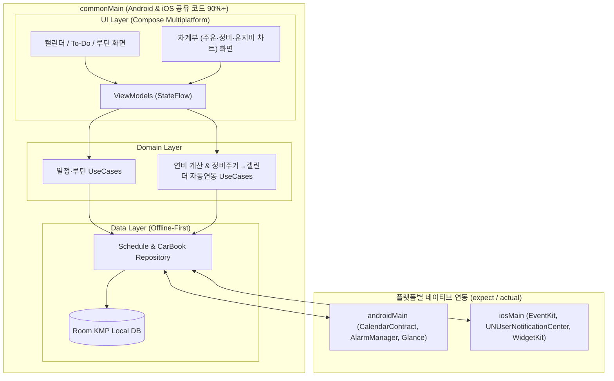

# 📱🚗 안드로이드 & iOS 공용 일정관리 + 차계부 앱 개발 계획서 (KMP / CMP)

사용자의 선택에 맞춰 **Kotlin Multiplatform (KMP) + Compose Multiplatform (CMP)** 기반의 **안드로이드(Android) 및 아이폰(iOS) 공용 앱** 개발 계획을 수립했습니다.  
기존의 **캘린더+할 일(To-Do)+루틴 관리** 기능에 더해, **차계부(주유/연비 계산, 정비·소모품 교체 주기 관리 및 캘린더 자동 연동, 차량 유지비 월별/연간 리포트)**를 하나의 앱으로 통합합니다.

---

## 1. 기술 스택 및 크로스 플랫폼 아키텍처 (KMP & CMP)

> [!IMPORTANT]
> **오프라인 우선(Offline-First)** 구조를 위해 멀티플랫폼을 지원하는 **Room KMP(SQLite)**를 단일 진실 공급원(Single Source of Truth)으로 사용하며, 추후 클라우드(Google Drive / iCloud / Firebase) 백업 및 기기 간 동기화를 확장할 수 있도록 설계합니다.

* **프레임워크 & UI**: Kotlin Multiplatform (KMP) + Compose Multiplatform (Material 3 기반 Android / iOS 100% 공유 UI)
* **아키텍처**: MVVM + Clean Architecture (`commonMain`에 UI, Domain, Data 레이어 통합)
* **의존성 주입 (DI)**: Koin (Multiplatform 공식 지원) 또는 Kotlin-Inject
* **로컬 데이터베이스 (Offline-First)**:
  * **Room KMP (2.7+)** + `BundledSQLiteDriver` (Android / iOS 공통 SQLite 엔진)
  * **DataStore KMP**: 사용자 테마, 기본 차량 설정, 단위(km/L 등) 저장
* **날짜/시간 처리**: `kotlinx-datetime` (플랫폼 독립적 날짜/시간 및 정비 예정일 계산)
* **플랫폼별 네이티브 연동 (`expect` / `actual`)**:
  * **캘린더 연동**: Android (`CalendarContract` / Google Calendar API), iOS (`EventKit` - Apple 캘린더 연동 및 Google 캘린더 계정 연동)
  * **로컬 알림**: Android (`AlarmManager` / `NotificationManager`), iOS (`UNUserNotificationCenter`)
  * **홈 화면 위젯**: Android (`Jetpack Glance`), iOS (`WidgetKit` 확장 가능)
  * **클라우드 백업 (추후 확장)**: 로컬 DB 스냅샷(JSON/SQLite) 내보내기 및 Firebase / Google Drive / iCloud 백업 모듈

---

## 2. 핵심 기능 상세 설계

### ① 캘린더(월/주/일) + 할 일(To-Do) + 루틴 통합 관리
* **통합 타임라인 뷰**: 선택한 날짜의 **일정(Schedule)**, **할 일(To-Do)**, **차량 정비/만기 알림 일정**을 한 화면에서 확인하고 체크 처리
* **유연한 뷰 전환**: 월간 ↔ 주간 ↔ 일간 뷰 전환 및 카테고리/색상 태그 지정
* **반복 루틴 트래커**: 매일/특정 요일 반복 습관 체크, 연속 달성(Streak) 및 달성률 통계 제공

### ② 스마트 차계부 (주유 · 정비 · 유지비 리포트)
* **주유 기록 및 평균 연비/유류비 자동 계산**:
  * 주유 일자, 주유 금액, 단가(원/L), 주유량(L), **누적 주행거리(Odometer, km)** 입력
  * 이전 주유 기록 대비 주행거리를 바탕으로 **구간 연비(km/L), 평균 연비, 1km당 주행 비용** 자동 산출
* **정비/소모품 교체 주기 관리 & 캘린더 일정 자동 연동**:
  * 엔진오일, 에어컨 필터, 브레이크 패드, 타이어 위치교환, 배터리 등 주요 소모품 항목 기본 제공 및 커스텀 추가
  * **교체 주기 이중 관리**: **주행거리 기준(예: 매 10,000km)** + **기간 기준(예: 매 6개월/1년)** 동시 설정
  * 정비 기록 입력 시 **다음 교체 예정일이 자동으로 캘린더 일정(`ScheduleEvent`) 및 리마인더 알림으로 등록**되며, 주행거리 입력 시 교체 도래율(%) 프로그레스 바 표시
* **차량 유지비 월별/연간 리포트 차트**:
  * 지출 카테고리: **주유(충전), 정비/수리, 주차비, 톨게이트(통행료), 세차, 자동차 보험료/할부/세금**
  * 월별/연간 총 지출 추이 막대그래프 및 카테고리별 지출 비중 도넛 차트 제공

### ③ 오프라인 우선 저장 & 클라우드 백업 아키텍처
* 인터넷 연결 없이도 즉시 기록·조회 가능한 **Room KMP 로컬 DB** 기반 동작
* 데이터 백업/복원(JSON/DB 파일 내보내기) 및 추후 **Google Drive / iCloud / Firebase** 연동을 통한 안드로이드 ↔ 아이폰 간 기기 변경/동기화 지원

---

## 3. 데이터베이스 핵심 스키마 (Room KMP Entities)

| 도메인 | 엔티티 (Entity) | 주요 필드 | 설명 |
| :--- | :--- | :--- | :--- |
| **일정/루틴** | `ScheduleEvent` | `id`, `externalEventId`, `title`, `startTime`, `endTime`, `isAllDay`, `category`, `linkedCarRecordId` | 일반 일정 및 차계부 연동 일정 (`linkedCarRecordId`로 정비 기록과 연결) |
| **일정/루틴** | `TodoItem` | `id`, `title`, `dueDate`, `priority`, `isCompleted`, `completedAt` | 일자별/기한별 할 일 항목 |
| **일정/루틴** | `Routine` / `RoutineLog` | `id`, `title`, `repeatDaysMask`, `date`, `isCompleted` | 반복 루틴 정의 및 일자별 달성 기록 |
| **차계부** | `Vehicle` | `id`, `name`, `model`, `fuelType`, `initialOdometer`, `currentOdometer`, `isDefault` | 등록 차량 정보 (다차량 확장 가능, 현재 누적 주행거리 관리) |
| **차계부** | `CarExpenseLog` | `id`, `vehicleId`, `date`, `type` (`FUEL`, `MAINTENANCE`, `PARKING`, `TOLL`, `INSURANCE`, `OTHER`), `amount`, `odometer`, `memo` | 모든 차량 지출 통합 원장 (월별/연간 유지비 리포트의 기준 데이터) |
| **차계부** | `FuelDetail` | `expenseId`, `unitPrice`, `liters`, `isFullTank`, `calculatedEfficiency` | 주유 상세 정보 및 자동 계산된 구간 연비(km/L) |
| **차계부** | `MaintenanceItem` | `id`, `vehicleId`, `partName`, `cycleKm`, `cycleMonths`, `lastReplacedDate`, `lastReplacedOdometer`, `nextDueDate`, `scheduledEventId` | 소모품/정비 항목별 교체 주기 설정 및 캘린더 일정(`ScheduleEvent`) 자동 매핑 키 |

---

## 4. 단계별 개발 로드맵 (Phased Roadmap)

* **Phase 1: KMP(Compose Multiplatform) 프로젝트 초기 세팅 및 공통 기반 구축** [✅ COMPLETED]
  * [x] `composeApp` (`commonMain`, `androidMain`, `iosMain`) 구조 생성 및 Gradle(Version Catalog `libs.versions.toml`) 설정
  * [x] Room KMP 2.7+ (8개 Entities, 2개 DAOs, `BundledSQLiteDriver`, expect/actual Platform DatabaseBuilder) 구현
  * [x] Koin DI (`DatabaseModule`) 및 `kotlinx-datetime`, `kotlinx-coroutines` 연동
  * [x] 하단 탭 네비게이션 구성: **[캘린더] · [할 일] · [루틴] · [타임라인]** (`App.kt` Material 3 NavigationBar)
* **Phase 2: 일정관리 (캘린더 + To-Do + 루틴) 핵심 기능 구현** [✅ COMPLETED]
  * [x] Schedule Domain 모델 (`ScheduleEvent`, `TodoItem`, `Routine`, `RoutineLog`, `Priority`)
  * [x] 비트마스크 기반 연속 달성 계산기 `RoutineStreakEngine` 및 단위 테스트 구현
  * [x] `ScheduleRepository` & `ScheduleRepositoryImpl` (Room `ScheduleDao` 연동)
  * [x] ViewModels (`CalendarViewModel`, `TodoViewModel`, `RoutineViewModel`, `TimelineViewModel`)
  * [x] Compose Multiplatform Material 3 화면 & 다이얼로그 (`CalendarScreen`, `TodoScreen`, `RoutineScreen`, `IntegratedTimelineScreen`, 바텀시트/다이얼로그)
  * [x] Koin DI 모듈 (`ScheduleModule`) 및 `App.kt` 탭 네비게이션 연동
* **Phase 3: 차계부 (주유/연비 계산 & 지출 기록) 구현** [✅ COMPLETED]
  * [x] 차량 등록(`Vehicle`), 다차량 지원 및 누적 주행거리 anti-rollback 검증 로직 구현
  * [x] 주유/정비/기타 지출 입력 바텀시트(`AddFuelBottomSheet`, `AddExpenseBottomSheet`, `VehicleProfileDialog`) 구현
  * [x] **Full-to-Full 평균 연비(km/L) & 1km 주행비 자동 계산기 `FuelEfficiencyEngine`** 및 단위 테스트 구현
  * [x] `CarBookRepository` & `CarBookRepositoryImpl` Room DAO 연동 및 `CarBookViewModel` 리액티브 상태 관리
  * [x] Compose Multiplatform Material 3 화면 `CarBookScreen`, Koin DI `CarBookModule`, `App.kt` 하단 탭 네비게이션 연동
* **Phase 4: 정비/소모품 교체 주기 관리 & 캘린더 자동 연동 + 리포트 차트** [✅ COMPLETED]
  * [x] Maintenance Domain 모델(`MaintenanceItem`, `MaintenanceStatus`, `MaintenancePreset`)
  * [x] **교체 주기 이중 관리 마모율 계산기 `MaintenanceWearEngine`** (주행거리/기간 max 마모율, 잔여거리/일수, 다음 교체 예정일 자동 산출) 및 단위 테스트 구현
  * [x] **정비 주기 ↔ 캘린더 양방향 연동 UseCase `SyncMaintenanceToScheduleUseCase`** (정비 항목 등록/변경 시 `ScheduleEvent` 캘린더 자동 등록, 정비 완료 시 지출 원장 기록 및 캘린더 일정 갱신)
  * [x] **월별/연간 유지비 집계 엔진 `ExpenseReportEngine`** (12개월 지출 추이, 카테고리별 비중 퍼센티지, 총액/월평균 통계)
  * [x] ViewModels (`MaintenanceViewModel`, `ExpenseReportViewModel`) 및 Koin DI 모듈 (`MaintenanceModule`, `ReportModule`)
  * [x] Compose Multiplatform Material 3 화면 & 다이얼로그 (`MaintenanceScreen`, `AddMaintenanceDialog`, `LogMaintenanceDialog`, `ExpenseReportScreen`)
  * [x] Custom Canvas 차트 구현 (월별 막대그래프 + 카테고리 도넛 차트 및 컬러 범례)
  * [x] `CarBookScreen` 4개 탭 연동 (`[주유 기록]` · `[정비/소모품]` · `[지출 내역]` · `[유지비 리포트]`)
* **Phase 5: 플랫폼 네이티브 연동 (캘린더 동기화, 알림, 로컬/클라우드 백업) 및 프로덕션 폴리싱** [✅ COMPLETED]
  * [x] **모던 머티리얼 3 테마 시스템 (`core/theme/`)**: Light/Dark 다이내믹 테마 팔레트, 인디고/에메랄드/앰버/크림슨 액센트 컬러, 통일된 타이포그래피(`Type.kt`) 및 16dp 라운드 쉐이프(`Theme.kt`)
  * [x] **설정 및 환경설정 화면 (`features/settings/`)**: 화면 테마 선택(시스템/라이트/다크), 기본 차량 선택 드롭다운, 거리/연료 단위(km/mi, L/gal), JSON 스냅샷 백업/복원, 앱 및 개발자 정보
  * [x] **플랫폼 네이티브 캘린더 연동 `PlatformCalendarSync`**: commonMain `expect class`, Android `CalendarContract`, iOS Apple `EventKit` (`EKEventStore`) 연동
  * [x] **플랫폼 로컬 알림 스케줄러 `PlatformNotificationScheduler`**: commonMain `expect class`, Android `AlarmManager` + `NotificationChannel`, iOS `UNUserNotificationCenter` 연동
  * [x] **Room 로컬 DB JSON 스냅샷 엔진 `DatabaseBackupEngine`**: 8개 엔티티 전체 데이터 무의존성 JSON 직렬화/파서, 트랜잭션 데이터 복원 및 무결성 검증
  * [x] **하단 5개 탭 네비게이션 최종 완성 (`App.kt`)**: [캘린더 & 할 일] · [스마트 차계부] · [루틴 & 습관] · [통합 타임라인] · [설정] 통합 연동
  * [x] **단위 테스트 및 QA 검증**: `DatabaseBackupEngineTest`, `SettingsViewModelTest` 포함 전체 E2E/단위 테스트 구축 완료
